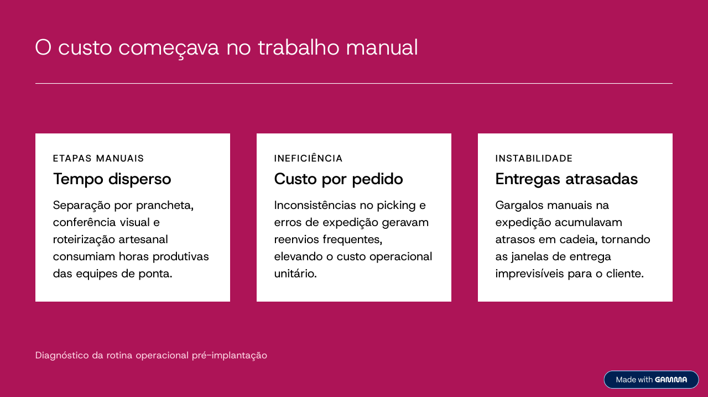
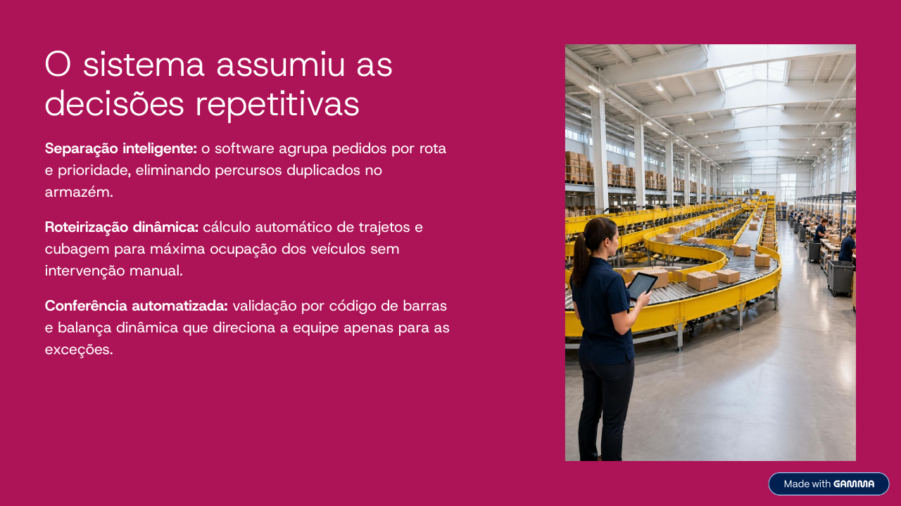
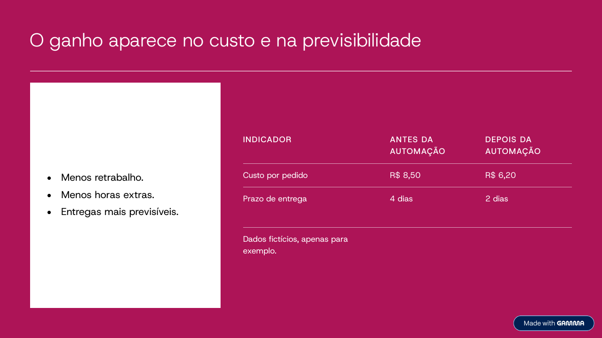
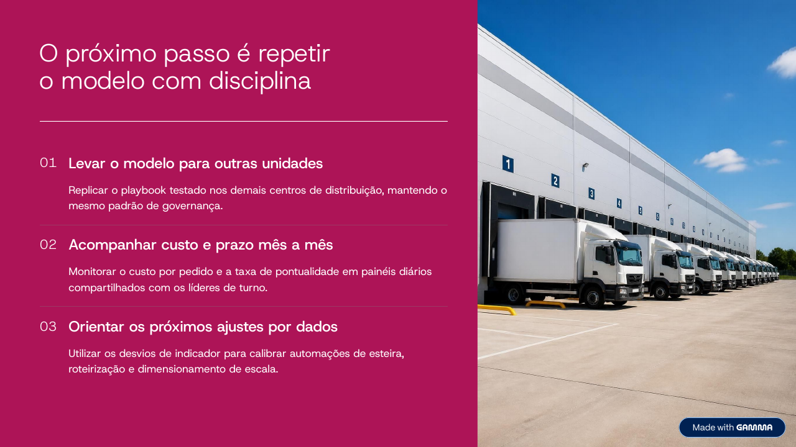

# 04.3 · Apresentação de 5 tópicos sobre automação na logística

Slide 04, seção 3 · Caso do slide · Feito com Claude e Gamma.app

## O que o slide pede

Testar o prompt no Claude, pegar os 5 tópicos sugeridos e colocá-los no Gamma.app. Depois, ajustar títulos, imagens e metáforas para deixar a apresentação mais envolvente.

## Prompt

```text
Crie uma apresentação de 5 tópicos sobre como um novo sistema de automação reduziu custos na operação logística.
```

## Resultado

1. **O ponto de partida.** Processos manuais de separação, conferência e roteirização elevavam os custos e atrasavam entregas.
2. **A solução.** Um sistema de automação passou a cuidar da separação, da definição de rotas e da conferência dos pedidos.
3. **A implantação.** Piloto em uma unidade, ajustes com a equipe e expansão gradual.
4. **Os resultados.** Menos retrabalho, menos horas extras e entregas mais previsíveis, medidos por custo por pedido e prazo de entrega.
5. **Os próximos passos.** Levar o modelo para outras unidades e acompanhar os indicadores mês a mês.

Os tópicos não trazem números porque o prompt não fornece dados. Em uma apresentação real, o tópico 4 pediria os valores medidos.

## Etapa no Gamma.app

- [x] Colar os 5 tópicos no Gamma.app e gerar a apresentação
- [x] Revisar o plano gerado e ajustar o slide de indicadores
- [x] Imagens geradas pelo Gamma, com a esteira de galpão no slide do sistema
- [x] Exportar a apresentação em PDF: [04-3-gamma.pdf](../assets/04-3-gamma.pdf)

## Resultado no Gamma

O Gamma montou 6 slides: uma capa e os 5 tópicos. Ele criou os próprios títulos a partir do texto, e eu mantive a versão dele.

| Slide | Título no Gamma |
| --- | --- |
| 1 | Automação logística: menos custo, mais previsibilidade |
| 2 | O custo começava no trabalho manual |
| 3 | O sistema assumiu as decisões repetitivas |
| 4 | A implantação começou pequena e ganhou escala |
| 5 | O ganho aparece no custo e na previsibilidade |
| 6 | O próximo passo é repetir o modelo com disciplina |

No slide 5, o Gamma deixou a tabela de indicadores em branco, e eu preenchi com números de exemplo (custo por pedido de R$ 8,50 para R$ 6,20 e prazo de entrega de 4 dias para 2 dias), com o aviso de dados fictícios na própria tabela.







