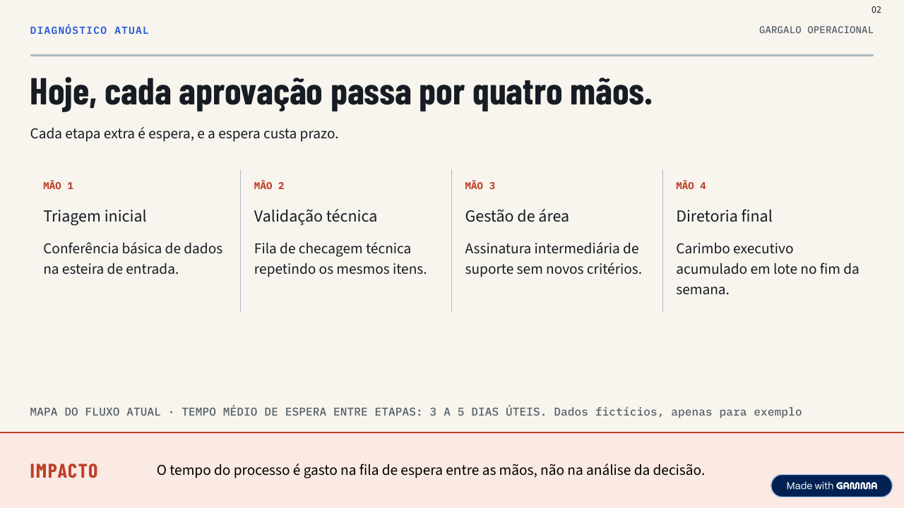
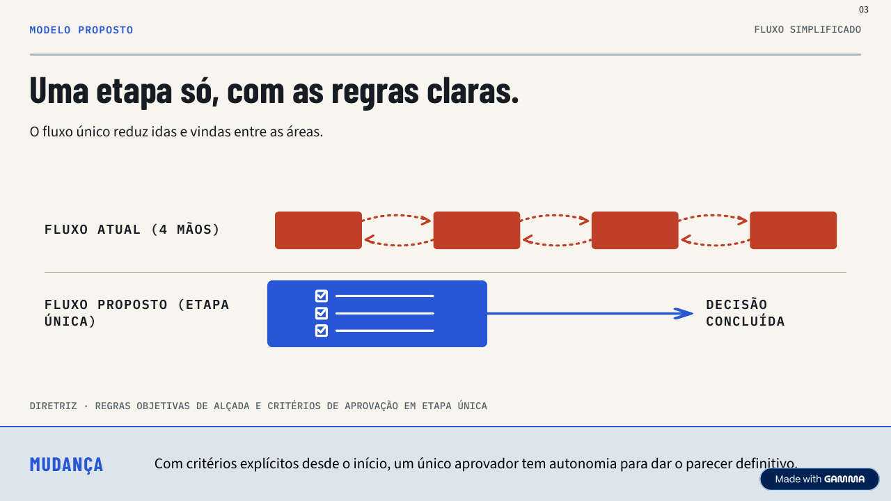
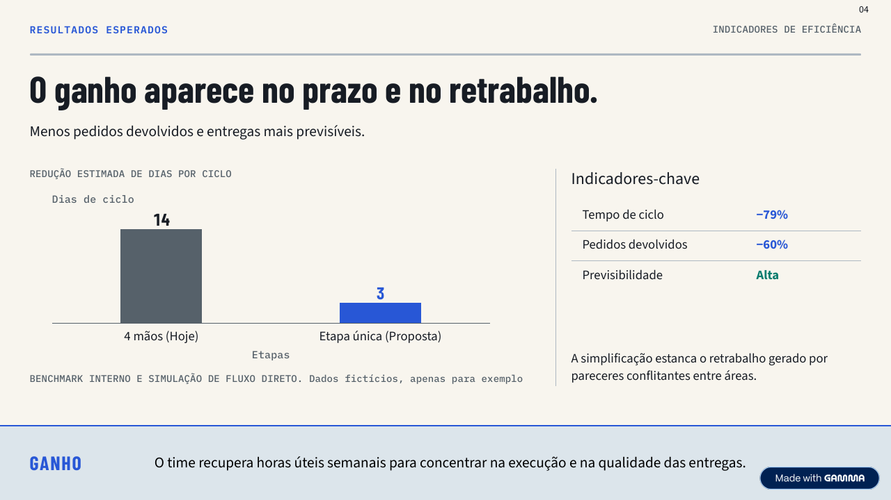
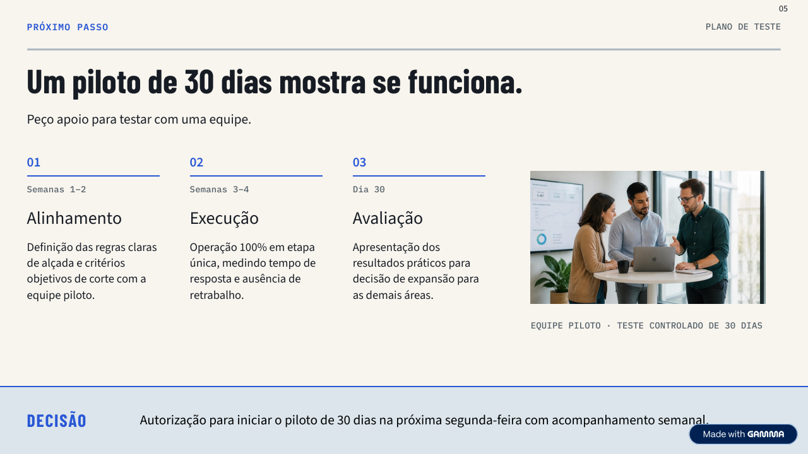

# 06.2 · Apresentação de 5 slides para uma melhoria em processo interno

Slide 06, seção 2 · Caso do slide · Feito com Claude e Gamma

## O que o slide pede

O slide divide em três etapas: esboço inicial e ajuste narrativo com IA generativa, e design final no Canva AI, no Gamma ou no Tome.ai. O prompt é o que está abaixo.

## Prompt

```text
Crie uma apresentação de 5 slides para apresentar uma ideia de melhoria em processo interno.
```

## Esboço inicial

| Slide | Conteúdo |
| --- | --- |
| 1 | Título e a ideia em uma frase |
| 2 | O problema: onde o processo atual perde tempo |
| 3 | A proposta: o que muda e como |
| 4 | O impacto: tempo ganho, erros evitados e retrabalho reduzido |
| 5 | Próximos passos e o que precisamos para começar |

## Ajuste narrativo

Pedido ao Claude: "Reescreva os títulos para que cada slide já entregue a conclusão e acrescente uma frase de apoio".

| Slide | Título | Frase de apoio |
| --- | --- | --- |
| 1 | Menos etapas, mais tempo para o que importa | Uma proposta para simplificar nosso fluxo de aprovação |
| 2 | Hoje, cada aprovação passa por quatro mãos | Cada etapa extra é espera, e a espera custa prazo |
| 3 | Uma etapa só, com as regras claras | O fluxo único reduz idas e vindas entre as áreas |
| 4 | O ganho aparece no prazo e no retrabalho | Menos pedidos devolvidos e entregas mais previsíveis |
| 5 | Um piloto de 30 dias mostra se funciona | Peço apoio para testar com uma equipe |

O processo é um exemplo genérico, porque o slide não define qual é. Os números reais só entram quando houver dados.

## Design final

- [x] Levar o conteúdo ao Gamma e gerar a apresentação de 5 slides
- [x] Marcar como fictícios os números que o Gamma criou
- [x] Exportar a apresentação em PDF: [06-2-design.pdf](../assets/06-2-design.pdf)

## Resultado no Gamma

O Gamma gerou os 5 slides com os títulos e as frases de apoio acima. Ele também criou números que o texto não trazia: o tempo de espera entre etapas (3 a 5 dias úteis), o gráfico de ciclo (14 dias para 3) e os indicadores de redução (−79% no tempo de ciclo e −60% nos pedidos devolvidos). Como são dados inventados, acrescentei o aviso "Dados fictícios, apenas para exemplo" nos slides 2 e 4 e corrigi o indicador de ciclo de −75% para −79%, para bater com o gráfico.






