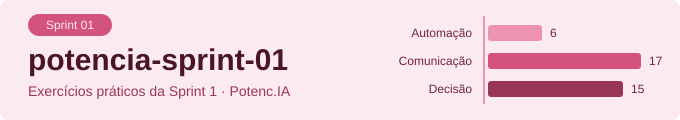

  

# potencia-sprint-01

Exercícios práticos da Sprint 1 do Potenc.IA, programa de formação em IA generativa da Prosper Digital Skills. O repositório guarda o que eu fui produzindo a cada prática: o prompt, o resultado e o que mudou quando ajustei o pedido.

A Sprint 1 tem 38 exercícios, em três assuntos: Automação, Comunicação Estratégica e Tomada de Decisão. O repositório está sendo montado aos poucos, e cada exercício entra quando fica pronto.

## Como ler este repositório

Cada prática dos slides tem um número no formato **slide.seção**. O 06.1, por exemplo, é a prática da seção 1 do Slide 06.

As práticas são de dois tipos:

- **Fixas:** o slide traz o prompt pronto, com o caso definido. Aqui eu segui o caso do slide.
- **Livres:** o slide pede algo meu, como uma tarefa do dia a dia, um projeto ou os meus dados. Aqui eu uso a minha rotina e os meus projetos de GitHub.

Quando o enunciado traz uma etapa em ferramenta própria (Gamma, Canva, Notion AI, Make, Miro, vídeo), o arquivo do exercício registra o que foi feito nela.

## Exercícios publicados

### Comunicação Estratégica

| Nº | Tipo | Exercício | Ferramenta |
| --- | --- | --- | --- |
| 04.3 | Fixa | [Apresentação de 5 tópicos sobre logística](02-comunicacao-estrategica/04-3-apresentacao-de-5-topicos-logistica.md) | Gamma.app |
| 06.2 | Fixa | [Apresentação de 5 slides para melhoria de processo](02-comunicacao-estrategica/06-2-apresentacao-de-5-slides.md) | Gamma.app |

## Como os exercícios foram feitos

Os textos foram gerados com o Claude. Os slides citam ChatGPT e Gemini nos enunciados, e eu usei o Claude no lugar. As ferramentas que fazem um trabalho próprio, como Gamma, Canva, Make, Miro e as de vídeo, continuam com o nome que está nos slides.

Os casos fictícios, as empresas inventadas e os números simulados estão sempre indicados no próprio exercício.
